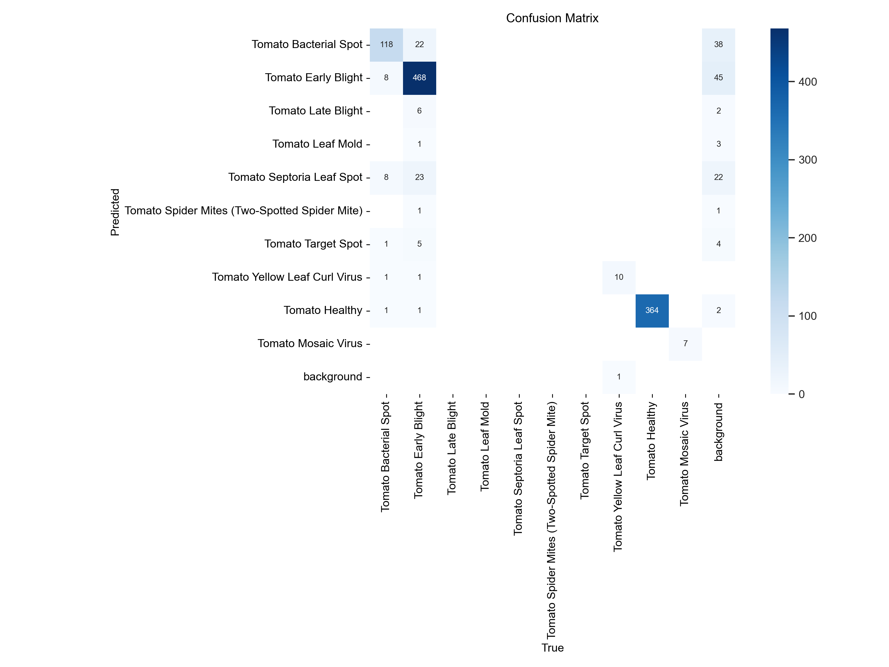
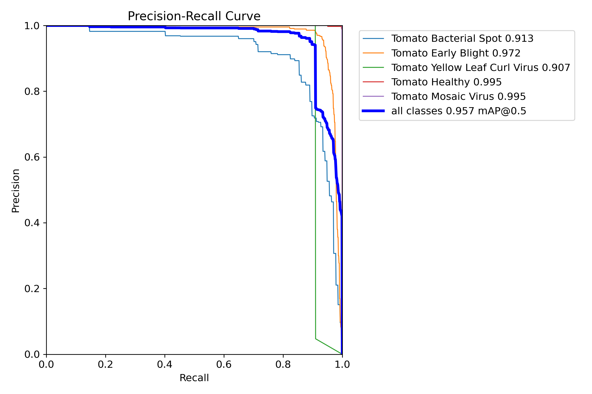

# Tomato Leaf Disease Detection

Fine-tuned YOLOv8 object detectors for tomato-leaf disease in field images, compared against a YOLOv5s benchmark.

## Results

Evaluated on the held-out test split (1,051 images, 1,047 labelled instances). Both YOLOv8 runs were trained on CUDA device 0: their `args.yaml` files record `device: 0`. The notebook's startup output names that device as an NVIDIA GeForce RTX 3060 Laptop GPU (6144 MiB). The YOLOv5s run's `opt.yaml` leaves `device` on auto, so the GPU is not confirmed for that run.

| Model | Test mAP@0.5 | Test mAP@0.5:0.95 | Inference per image |
|---|---|---|---|
| YOLOv8s (15 epochs set, batch 8) | 0.957 | 0.826 | 5.7 ms |
| YOLOv8n (10 epochs, batch 16) | 0.954 | **0.840** | 2.8 ms |
| YOLOv5s benchmark (15 epochs, batch 8) | 0.924 | 0.688 | not measured |

- The YOLOv8s run was set to 15 epochs but stopped early at epoch 13 (EarlyStopping, patience 5). Its best validation mAP@0.5 was at epoch 8.
- Both YOLOv8 models beat the YOLOv5s baseline by about 0.03 mAP@0.5 and 0.14 to 0.15 mAP@0.5:0.95.
- The nano model has about 3.0 M parameters against 11.1 M for the small model, runs about twice as fast, and loses only 0.003 mAP@0.5. The notebook picks it as the better model for edge or mobile use.
- Caveat on the YOLOv5s row: in the notebook its test mAP values (0.924, 0.688) are typed in by hand after running `val.py`, not read from its output. Its validation score at the last epoch (mAP@0.5 0.823, mAP@0.5:0.95 0.685) is in `model_artifacts/yolov5s_tomato_benchmark_minimal/results.csv`.

YOLOv8s test-set evaluation (`model_artifacts/yolov8s_tomato_tuned_TEST_eval/`):

| Confusion matrix | Precision-recall curve |
|---|---|
|  |  |

The folder name says "tuned", but both YOLOv8 test evaluations were written to the same folder and the YOLOv8s run was evaluated last, so these plots come from the YOLOv8s model.

## Problem

Tomatoes can be affected by over 200 diseases (Singh, Singh and Kumar, 2017, as cited in the notebook). Surveying plantations by hand is slow, costly and unreliable. The goal is a detector that takes a leaf photo and returns bounding boxes with a disease class, fast enough for real-time use (the notebook sets a floor of 15 FPS).

## Data

[Tomato Leaf Disease Detection - YOLOv8 dataset](https://www.kaggle.com/datasets/vasantharank/tomato-leaf-disease-detection-yolov8-dataset) on Kaggle.

- 10,853 images, 640x640 JPG, YOLO-format annotations.
- Split: 7,842 train, 1,960 validation, 1,051 test.
- 10 classes: Bacterial Spot, Early Blight, Late Blight, Leaf Mold, Septoria Leaf Spot, Spider Mites, Target Spot, Yellow Leaf Curl Virus, Healthy, Mosaic Virus.
- The classes are imbalanced. The notebook notes that Bacterial Spot and Late Blight are under-represented.

The data is not in this repo. Download it and place it in a `data/` folder next to the notebook.

## Approach

- Fine-tune pretrained YOLOv8s with Ultralytics defaults (including mosaic, flip and colour augmentation), 640 px input, early stopping with patience 5.
- Fine-tune YOLOv8n with fewer epochs and a larger batch, to test whether a much smaller model holds up.
- Train YOLOv5s with the Ultralytics YOLOv5 repo, using the same epochs, batch size and patience as the YOLOv8s run, as the baseline.
- Report mAP@0.5, mAP@0.5:0.95, precision, recall and inference time. Compare training curves on the validation split and final models on the test split.
- The notebook calls the YOLOv8n run "refined" or "tuned". It changes model size and training length; it is not a hyperparameter search.

## Repo contents

| Path | What it is |
|---|---|
| `tomatyolov8.ipynb` | Full workflow: problem definition, data analysis, training, evaluation, conclusion |
| `model_artifacts/yolov8s_tomato_light/` | YOLOv8s run: curves, results.csv, args, weights |
| `model_artifacts/yolov8s_tomato_tuned/` | YOLOv8n run (folder name kept from the notebook): curves, results.csv, args, weights |
| `model_artifacts/yolov5s_tomato_benchmark_minimal/` | YOLOv5s benchmark run |
| `model_artifacts/*_TEST_eval/` | Test-split evaluation plots (see the note above about the YOLOv8 folder) |
| `Proposal.pdf`, `project_report.pdf` | Capstone proposal and final report |
| `requirements.txt` | Environment export (Python 3.10, PyTorch 2.5.1 + CUDA 12.1, Ultralytics 8.3.100). It is UTF-16 and conda-style, so it will not work directly with `pip` |

## How to run

The project is notebook-only. There is no standalone training script.

```bash
git clone https://github.com/ultralytics/yolov5      # used by the YOLOv5s benchmark cells
conda create -n tomato python=3.10 && conda activate tomato
pip install ultralytics==8.3.100 pandas matplotlib seaborn pyyaml jupyter
pip install -r yolov5/requirements.txt
jupyter notebook tomatyolov8.ipynb
```

Put the Kaggle dataset in `data/` (with `train/`, `valid/`, `test/` and `data.yaml`) first. Training used a CUDA GPU (the notebook output shows an RTX 3060 Laptop GPU). The YOLOv5 cells use the relative path `yolov5` and build absolute paths at run time with `os.path.abspath`. The author's Windows paths appear only in saved cell outputs, so the code cells need no path edits; the clone must be named `yolov5` and sit next to the notebook.

## Limitations and next steps

- Each model was trained once, with one seed, for 10 to 15 epochs. The 0.003 mAP@0.5 gap between YOLOv8s and YOLOv8n is too small to call a real difference.
- The YOLOv5s comparison is not fully clean: its test scores were hard-coded, and it uses a different code base with different default augmentations.
- No hyperparameter search, no check for near-duplicate images across splits, and no test on photos from other farms or cameras.
- Next steps: repeat runs with several seeds, add a script version of the pipeline, test the nano model on a device, and evaluate on images from outside this dataset.

Coursework: capstone project (see `Proposal.pdf` and `project_report.pdf`).
